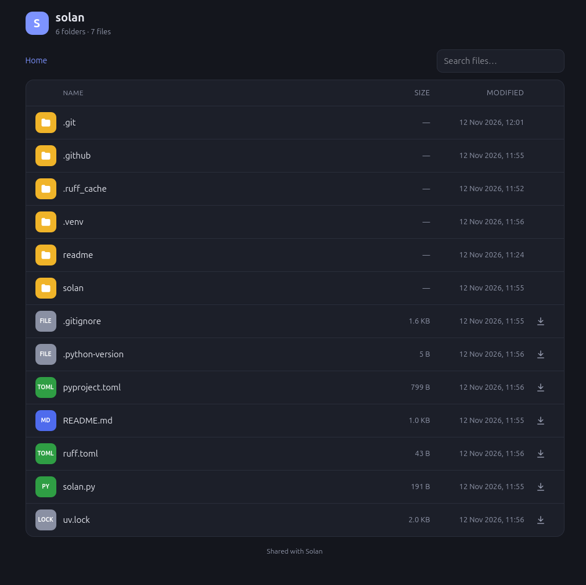

# Share your files. Everywhere.

Solan is a simple and basic system to share files with other people

## Installation

Install Solan from Pypi

    $ pipx install solan

or install Solan as a command-line tool with [uv](https://docs.astral.sh/uv/)

    $ uv tool install solan

or run it without installing

    $ uvx solan [path_to_share]

### Development

    $ git clone https://github.com/OpenCode/solan.git && cd solan
    $ uv sync
    $ uv run solan [path_to_share]

## Usage

    $ solan [path_to_share]

and then open your browser and visit the url printed in your terminal

### Examples:

    $ solan /tmp

or you can define a different port (standard is 8000)

    $ solan ~/Example/Share -p 8004

#### Remote access

Enable remote with -r parameter

    $ solan -r /tmp

#### In action

## Support

