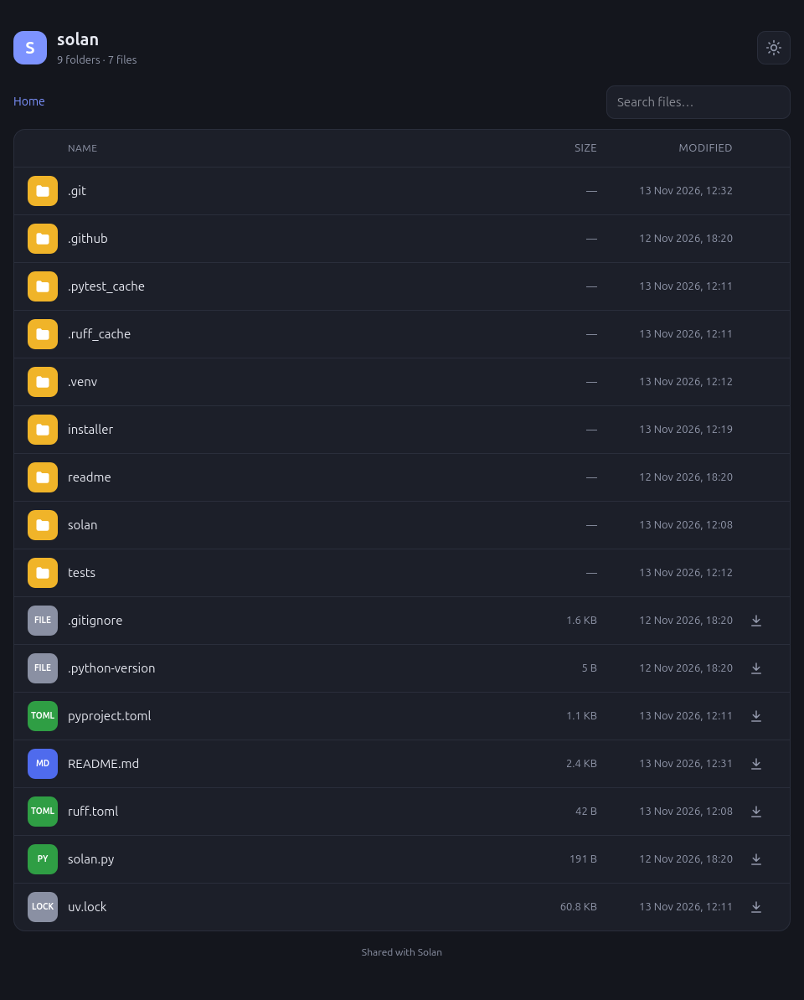
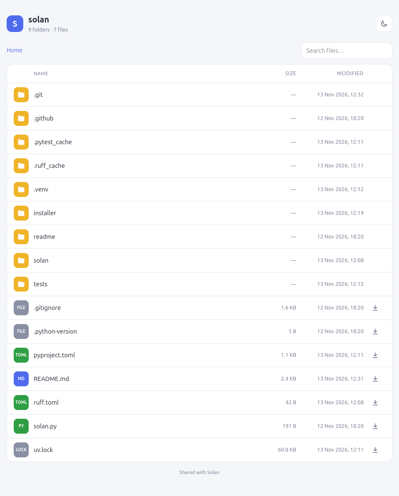

# Share your files. Everywhere.

Solan is a multi-system command-line software, written in Python, used to share files from a local computer.

When a directory is shared with Solan, every browser (or similar) can be used to navigate files and download them.Solan is a simple and basic system to share files with other people in the same net

## Installation

### Linux

Install Solan from Pypi

    $ pipx install solan

or install Solan as a command-line tool with [uv](https://docs.astral.sh/uv/)

    $ uv tool install solan

or run it without installing

    $ uvx solan [path_to_share]

### Others

Download the installer for your system from the [latest release](https://github.com/OpenCode/solan/releases/latest):

- **Windows**: `solan-<version>-windows-setup.exe` installs Solan for the current user and adds it to the PATH.
- **macOS** (Apple Silicon): `solan-<version>-macos-arm64.pkg` installs Solan in `/usr/local/bin`.

The installers are not signed yet: Windows SmartScreen may ask to confirm ("More info" → "Run anyway"),
and on macOS you may need to right-click the `.pkg` and choose "Open".

## Development

    $ git clone https://github.com/OpenCode/solan.git && cd solan
    $ uv sync
    $ uv run solan [path_to_share]

## Usage

### Linux and MacOS

    $ solan [path_to_share]

and then open your browser and visit the url printed in your terminal

### Windows

Right-click a folder (or the empty area inside it) and choose **Share with Solan** — on Windows 11 it's under "Show more options".
A window opens with the address to share; close it to stop sharing.
You can also open a new terminal and run `solan`.

## Examples:

    $ solan /tmp

or you can define a different port (standard is 8000)

    $ solan ~/Example/Share -p 8004

## Remote access

Enable remote with -r parameter

    $ solan -r /tmp

## In action

## Support

